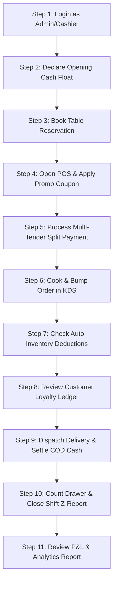

# 📋 Complete Testing & End-to-End User Flow Guide
**Restaurant & Fast Food Management Desktop System (Offline-First)**  
*Document Reference: `docs/specification.txt` (October 2026)*  
*Platform: Electron + React 18 + SQLite (better-sqlite3) + Tailwind CSS*

---

## 📑 Table of Contents
1. [Overview & Testing Prerequisites](#1-overview--testing-prerequisites)
2. [Default Credentials & Test Accounts](#2-default-credentials--test-accounts)
3. [Automated Headless Test Suites (10 Test Suites)](#3-automated-headless-test-suites-10-test-suites)
4. [Complete End-to-End Interactive User Flow (11 Steps)](#4-complete-end-to-end-interactive-user-flow-11-steps)
   - [Step 1: Application Launch & Authentication](#step-1-application-launch--authentication)
   - [Step 2: Shift Opening & Cash Drawer Float](#step-2-shift-opening--cash-drawer-float)
   - [Step 3: Table Reservations & Guest Seating](#step-3-table-reservations--guest-seating)
   - [Step 4: Point of Sale (POS) Order & Promo Coupons](#step-4-point-of-sale-pos-order--promo-coupons)
   - [Step 5: Multi-Tender Split Payment & Receipt](#step-5-multi-tender-split-payment--receipt)
   - [Step 6: Kitchen Display System (KDS) & Stations](#step-6-kitchen-display-system-kds--stations)
   - [Step 7: Automated Inventory Deductions & Costing](#step-7-automated-inventory-deductions--costing)
   - [Step 8: Customer CRM Profiles & Loyalty Ledger](#step-8-customer-crm-profiles--loyalty-ledger)
   - [Step 9: Delivery Dispatch & Cash-On-Delivery (COD) Settlement](#step-9-delivery-dispatch--cash-on-delivery-cod-settlement)
   - [Step 10: Shift Closure, Cash Counting & Z-Report](#step-10-shift-closure-cash-counting--z-report)
   - [Step 11: Business Intelligence Reports, Settings & Kiosk](#step-11-business-intelligence-reports-settings--kiosk)
5. [Troubleshooting & Database Maintenance](#5-troubleshooting--database-maintenance)

---

## 1. Overview & Testing Prerequisites

The system is a 100% offline-first desktop application designed for high-volume restaurants, cafes, and fast-food chains. All data is persisted locally in an ACID-compliant SQLite database using `better-sqlite3` with Write-Ahead Logging (WAL) mode.

### System Requirements:
- **Operating System**: Windows 10/11 (or macOS / Linux)
- **Node.js**: v18.x or v20.x
- **Development Server**: Vite + Electron runtime

### How to Run the Application:
Open PowerShell or Terminal in the project root:
```powershell
# Navigate to workspace
cd D:\Restaurant\restaurant-management

# Start Vite + Electron desktop application
npm run dev
```

---

## 2. Default Credentials & Test Accounts

The database comes pre-seeded with operational roles, permissions, and test accounts:

| Role | Username | Password | 4-Digit Quick PIN | Modules Access |
| :--- | :--- | :--- | :--- | :--- |
| **Super Administrator** | `admin` | `admin123` | `1234` | Full access to all 11 modules, settings, and database tools |
| **Restaurant Manager** | `manager` | `manager123` | `2345` | Orders, menu, inventory, shifts, staff, CRM, reports |
| **Senior Cashier** | `cashier` | `cashier123` | `3456` | POS terminal, cash drawer, split billing, customer search |
| **Head Waiter** | `waiter` | `waiter123` | `4567` | Floor map, table occupancy, table orders, order transfers |
| **Head Chef** | `chef` | `chef123` | `5678` | Kitchen Display System (KDS), station bump bars |

> [!NOTE]
> When switching between active cashiers or staff on the floor, you can either log out or use the 4-digit PIN unlock for instant user switching.

---

## 3. Automated Headless Test Suites (10 Test Suites)

Before or after making any changes, you can verify every database model, business rule, constraint, and calculation via automated headless Electron test suites.

Each test executes against an isolated scratch database in seconds and verifies database transactions, error handling, foreign keys, and edge cases.

### Command Quick-Reference:

```powershell
# 1. Core Database Engine & Connection
npm run test:db

# 2. Authentication, RBAC Permissions & PIN Login
npm run test:auth

# 3. Menu Catalog, Variations, Modifiers & Combos
npm run test:catalog

# 4. POS Terminal, Floor Tables & Multi-Tender Split Billing
npm run test:pos

# 5. Kitchen Display (KDS) Stations, Timers & Order Bump
npm run test:kitchen

# 6. Inventory Stock, Recipe Costing, POs & Expenses
npm run test:inventory

# 7. Cash Drawer Shifts, Z-Reports & Staff Attendance
npm run test:staff

# 8. Customer CRM, Loyalty Ledger, Reservations & Coupons
npm run test:crm

# 9. Delivery Dispatch, Riders Fleet & COD Settlements
npm run test:delivery

# 10. Reports, Profit & Loss, Settings & Audit Logs
npm run test:reports
```

### Detailed Summary of Automated Test Suites:

| Test Script | Test Purpose & Assertions |
| :--- | :--- |
| `test:db` | Verifies SQLite Write-Ahead Logging (WAL), foreign key enforcement, hot backup generation, and schema migration integrity. |
| `test:auth` | Verifies secure password hashing, 4-digit PIN authentication, session expiration, and role-based access permission barriers. |
| `test:catalog` | Verifies categories, products, multi-size variations, add-on modifier groups, and promotional combo meal deal pricing calculations. |
| `test:pos` | Verifies order creation, cart subtotal calculations, dining table occupancy toggles, table transfers, and multi-tender split payments (Cash, Card, Online). |
| `test:kitchen` | Verifies automatic routing of order items to kitchen stations (Grill, Pizza, Drinks), station item status bumps (`PREPARING` → `READY`), and auto-promotion of parent order. |
| `test:inventory` | Verifies recipe bill-of-materials (BOM), automatic inventory deduction upon order completion, low-stock warnings, purchase order receiving, and expense categorization. |
| `test:staff` | Verifies cashier float opening, cash in/out movements, mid-shift X-Report, shift closing denomination counting, automated cash overage/shortage variance calculation, and staff clock-in/out attendance logs. |
| `test:crm` | Verifies customer VIP tagging, duplicate phone blocking, loyalty points earning and redemption ledger, double-booking reservation prevention, and promotional coupon rule enforcement (min spend, percentage, fixed discount). |
| `test:delivery` | Verifies delivery zones, rider fleet management, dispatch state transitions (`PENDING` → `ASSIGNED` → `OUT_FOR_DELIVERY` → `DELIVERED`), Cash-on-Delivery (COD) balance calculation, and cashier COD remittance settlement. |
| `test:reports` | Verifies sales summary aggregations, top-selling product velocity, 24-hour rush distribution, financial Profit & Loss statement (Revenue - COGS - Expenses), void audits, and system settings batch updates. |

---

## 4. Complete End-to-End Interactive User Flow (11 Steps)

Follow this realistic, 11-step manual testing scenario to experience the complete restaurant lifecycle from morning shift opening to end-of-day financial closing:



---

### Step 1: Application Launch & Authentication
1. Launch the app (`npm run dev`).
2. The **Login Screen** appears with a dark aesthetic.
3. Test **Username / Password Login**:
   - Enter `admin` / `admin123` and click **Sign In**.
   - Verify the top navigation bar displays `Administrator (Super Administrator)`.
4. Test **4-Digit Quick PIN Switching**:
   - Click the user avatar in the top right and click **Lock Screen**.
   - On the PIN keypad, enter `1234` to unlock immediately.

---

### Step 2: Shift Opening & Cash Drawer Float
1. In the sidebar, navigate to **Cash Drawer & Shifts** (`Phase 8`).
2. If no shift is open, you will see the **Shift Inactive - Start Drawer Shift** screen.
3. Click **Open Cash Drawer Shift**.
4. In the modal:
   - Click the `$100.00` preset float button (or enter `100.00`).
   - Add notes: `Morning Shift Opening Float`.
   - Click **Confirm & Open Shift Drawer**.
5. **Expected Outcome**:
   - Shift status changes to **ACTIVE SHIFT IN PROGRESS**.
   - Expected Drawer Cash shows `$100.00`.
   - Starting Cash Float shows `$100.00`.

---

### Step 3: Table Reservations & Guest Seating
1. Navigate to **Reservations** (`Phase 9`).
2. Review the daily bookings schedule for today.
3. Click **New Reservation**:
   - **Guest Name**: `Victoria Sterling`
   - **Phone**: `+1 555-9001`
   - **Party Size**: `4` guests
   - **Start Time**: Choose current hour (e.g. `19:00`)
   - Click **Check Available Tables** to verify real-time table availability.
   - Choose `Table T-02 (Main Dining Hall)`.
   - **Deposit Paid**: Enter `20.00` (Credit Card).
   - Click **Confirm Reservation**.
4. **Expected Outcome**:
   - Reservation appears with status `CONFIRMED`.
   - Navigate to **Table & Floor Map** (`Phase 5`): Table `T-02` is now highlighted in Amber as `RESERVED`.
5. Back in **Reservations**, click **Seat Guest**:
   - Booking status transitions to `SEATED`.
   - Table `T-02` automatically updates to Green/Red `OCCUPIED`.
   - Click **Open POS** to start ordering for this table!

---

### Step 4: Point of Sale (POS) Order & Promo Coupons
1. Navigate to **Point of Sale (POS)** (`Phase 5`).
2. If seated from Table `T-02`, the table is already selected in the cart header.
3. Tap on menu categories (e.g. `Burgers`, `Beverages`, `Sides`):
   - Add `Classic Angus Cheeseburger` to the cart.
   - Add `Crispy Seasoned Fries`.
   - Add `Craft Soda / Lemonade`.
4. Test **Cart Modifications**:
   - Increase burger quantity to `2`.
   - Click on the item note icon and type: `Extra crispy bacon, sauce on side`.
5. Test **Promotional Coupon Engine**:
   - In the cart summary, click **Discount (-$0.00)**.
   - In the modal, select the **Promo Voucher** tab.
   - Type coupon code `WELCOME10` and click **Check**:
     - System displays: `10% Welcome Discount` with green verification badge.
     - Click **Apply Voucher**.
   - Verify cart subtotal is reduced by 10% (capped at max rule).
   - Alternatively, test minimum spend rule: enter `LUNCH5` on an order below `$25.00` to verify it displays the minimum spend requirement.

---

### Step 5: Multi-Tender Split Payment & Receipt
1. In the POS cart, review the breakdown:
   - Subtotal, Discount, VAT/Tax (5%), Service Charge, and Grand Total.
2. Click **Proceed to Payment**:
   - The **Multi-Tender Split Payment Modal** opens.
   - Total amount due is displayed (e.g., `$35.50`).
3. Test **Split Billing**:
   - Select **CASH**: Enter `$20.00` and click **Add Tender Line**.
   - Notice Remaining Due automatically updates to `$15.50`.
   - Select **CARD**: Enter `$15.50` with reference code `AUTH-9882` and click **Add Tender Line**.
   - Remaining Due reaches `$0.00` and the **Complete Order & Print Receipt** button glows green.
4. Click **Complete Order & Print Receipt**:
   - The **Thermal Receipt Modal** pops up with formatted store header, itemized list, VAT breakdown, payment tenders, and footer thank-you message.
   - Click **Print Receipt** (or close).
5. Table `T-02` resets back to `AVAILABLE`.

---

### Step 6: Kitchen Display System (KDS) & Stations
1. In the sidebar, navigate to **Kitchen Display (KDS)** (`Phase 6`).
2. The newly created order appears instantly in the kitchen queue.
3. Inspect the ticket:
   - Order number, table number, elapsed timer (color changes green → amber → red if delayed).
   - Custom notes (`Extra crispy bacon, sauce on side`).
4. Test **Station Filtering**:
   - Click **Grill Station**: Only the burger item appears.
   - Click **Drinks Station**: Only the beverage appears.
   - Click **Expo / All Stations**: The complete unified order appears.
5. Test **Item Bumping**:
   - Click on the burger item: Status changes from `PENDING` to `PREPARING`.
   - Click it again: Changes to `READY`.
   - When all items are marked `READY`, the order header automatically lights up as `READY FOR PICKUP`.
6. Click **Bump Order (Serve)**: The ticket is cleared from the active queue.

---

### Step 7: Automated Inventory Deductions & Costing
1. Navigate to **Inventory & Stock** (`Phase 7`).
2. Inspect the raw materials list:
   - `Beef Patty (Angus)`: Current stock has automatically decreased based on the burger recipe BOM.
   - `Burger Buns`: Stock decreased by 2 units.
   - `Cheddar Cheese Slices`: Stock decreased by 2 slices.
3. Test **Manual Stock Adjustment**:
   - Click **Adjust Stock** next to `Fresh Tomatoes`.
   - Select reason: `Wastage / Spoiled`.
   - Enter `-1.5` kg and save.
   - Check the **Stock Movements Audit Log** tab to see the timestamped entry.
4. Navigate to **Purchases & Vendors**:
   - Review vendor roster (e.g. `Sysco Quality Meats`).
   - Click **Create Purchase Order (PO)** to order additional raw ingredients.
   - Receive the PO to see the stock automatically replenish in the inventory master!

---

### Step 8: Customer CRM Profiles & Loyalty Ledger
1. Navigate to **Customers & Loyalty** (`Phase 9`).
2. Review the customer roster with tier badges (`VIP`, `REGULAR`, `CORPORATE`).
3. Click on **Victoria Sterling** (`VIP`):
   - Notice her lifetime spend and completed orders count have increased.
4. Click the **History & Points Ledger** icon:
   - Review every individual points transaction (`EARN`, `REDEEM`, `BONUS`).
5. Click **Adjust Loyalty Points**:
   - Select type: `BONUS`.
   - Enter `100` points.
   - Note: `Birthday loyalty gift points`.
   - Click **Commit Points**.
   - Balance immediately updates with an audit trail entry.

---

### Step 9: Delivery Dispatch & Cash-On-Delivery (COD) Settlement
1. In **POS**, create a **DELIVERY** order:
   - Select `Delivery` order type.
   - Add items (e.g. `Family Combo Feast`).
   - In Customer lookup, enter: `Rachel Adams`, `+1 555-3211`, Address: `450 Innovation Way`.
   - Choose **Unpaid / COD (Cash On Delivery)**.
   - Finalize the order.
2. Navigate to **Delivery & Riders** (`Phase 10`):
   - On the **Live Board**, the order is under `PENDING`.
3. Click **Assign Rider**:
   - Select `Marco Silva` (Motorcycle) and click **Confirm Assignment**.
   - Rider status changes to `ASSIGNED`.
4. Click **Dispatch Trip**:
   - Order moves to `OUT_FOR_DELIVERY`.
   - Rider status becomes `OUT_FOR_DELIVERY`.
5. Click **Delivered**:
   - Enter collected cash (e.g. `$25.00`).
   - Order transitions to `DELIVERED`.
   - Rider returns automatically to `AVAILABLE`.
6. Test **Cashier COD Settlement**:
   - Switch to the **Riders Fleet** tab.
   - `Marco Silva` shows `Unsettled COD: $25.00`.
   - Click **Settle Cash ($25.00)**.
   - Review the order remittance list and click **Confirm Cash Received**.
   - Driver COD balance resets to `$0.00` and creates an entry in **COD History**!

---

### Step 10: Shift Closure, Cash Counting & Z-Report
1. Navigate back to **Cash Drawer & Shifts** (`Phase 8`).
2. Review the live shift figures:
   - Opening float: `$100.00`.
   - Cash sales collected: automatically computed from POS payments.
   - COD cash remitted: accounted for in drawer cash.
   - Expected Drawer Cash is calculated.
3. Test **Mid-Shift X-Report**:
   - Click **View X-Report (Mid-Shift)**.
   - An interim audit receipt displays live sales without closing the shift.
4. Click **Close Shift & Generate Z-Report**:
   - The **Denomination Breakdown Modal** opens.
   - Enter actual counted currency:
     - 1 × `$100` bill
     - 2 × `$20` bills
     - 5 × `$5` bills, etc.
   - The system displays real-time **Counted vs Expected** with exact **Variance** (Over / Short).
   - Enter closing notes: `Drawer balanced, register reconciled`.
   - Click **Finalize & Lock Shift (Z-Report)**.
5. **Expected Outcome**:
   - The formal, immutable **Z-Report Statement** is generated.
   - Shows shift open/close timestamps, cashier name, gross sales, tax, net sales, expected cash, counted cash, and variance.
   - Shift closes and drawer resets for the next employee.

---

### Step 11: Business Intelligence Reports, Settings & Kiosk
1. Navigate to **Reports & Analytics** (`Phase 11`):
   - **Sales Summary**: View total sales, average order value, sales by dining channel (Dine-in vs Delivery vs Takeaway), and tender split.
   - **Product Velocity**: Check top-selling menu items ranked by quantity and revenue.
   - **Peak Rush Hours**: Inspect the 24-hour customer volume heatmap.
   - **Profit & Loss (P&L)**: Inspect live Revenue, COGS, Expenses, and Net Profit Margin %.
   - **Audits**: Review voided, cancelled, and discounted orders with cashier names.
2. Navigate to **Settings & Audit Logs** (`Phase 11`):
   - Edit restaurant name, contact phone, or tax rates and click **Save Settings**.
   - Under the **Database** tab, click **Backup Now** to trigger an instantaneous hot backup of SQLite.
   - Inspect the **Audit Trail** tab to view logged administrative actions.
3. Navigate to **QR & Kiosk Center** (`Phase 11`):
   - **Table QR Standees**: View and print generated table QR code cards.
   - **Kiosk Simulator**: Click the Kiosk tab to launch the interactive touch terminal. Place a self-service order and see it route immediately to the KDS!

---

## 5. Troubleshooting & Database Maintenance

### Database Storage Location:
The SQLite database file is stored locally at:
```
D:\Restaurant\restaurant-management\database_storage\restaurant_pos.sqlite
```

### Hot Backup Files:
Backups created via the Settings tab or automated jobs are saved to:
```
D:\Restaurant\restaurant-management\database_storage\backups\
```

### Resetting to Clean Seed Data:
If you ever wish to reset the database to a fresh state with default operational data:
1. Stop the running dev server (`Ctrl+C` in PowerShell).
2. Delete the file `restaurant_pos.sqlite` in `database_storage/`.
3. Restart the dev server (`npm run dev`).
4. The migration runner will automatically apply migrations v1 through v8 and populate fresh seed data.

---

## 🏆 Summary Checklist

| Module / Flow | Operational Status | Verified By |
| :--- | :---: | :--- |
| **Authentication & RBAC** | ✅ PASSED | `npm run test:auth` & Login Screen |
| **Menu Catalog & Combos** | ✅ PASSED | `npm run test:catalog` & Product Manager |
| **POS Terminal & Split Payments** | ✅ PASSED | `npm run test:pos` & POS View |
| **Table & Floor Management** | ✅ PASSED | `npm run test:pos` & Floor Layout |
| **Kitchen Display (KDS)** | ✅ PASSED | `npm run test:kitchen` & KDS Screen |
| **Inventory & Food Costing** | ✅ PASSED | `npm run test:inventory` & Inventory View |
| **Cash Drawer Shifts & Z-Reports** | ✅ PASSED | `npm run test:staff` & Shifts View |
| **Staff Attendance & Roster** | ✅ PASSED | `npm run test:staff` & Staff View |
| **Customer CRM & Loyalty Points** | ✅ PASSED | `npm run test:crm` & Customers View |
| **Table Reservations Schedule** | ✅ PASSED | `npm run test:crm` & Reservations View |
| **Promotional Coupons Engine** | ✅ PASSED | `npm run test:crm` & POS Cart |
| **Delivery & Riders Dispatch** | ✅ PASSED | `npm run test:delivery` & Dispatch View |
| **Cash-on-Delivery (COD) Remittance** | ✅ PASSED | `npm run test:delivery` & Settle Modal |
| **Reports & P&L Statement** | ✅ PASSED | `npm run test:reports` & Reports View |
| **System Settings & Backup** | ✅ PASSED | `npm run test:reports` & Settings View |
| **QR Standees & Kiosk Simulator** | ✅ PASSED | `npm run build:vite` & Kiosk View |
