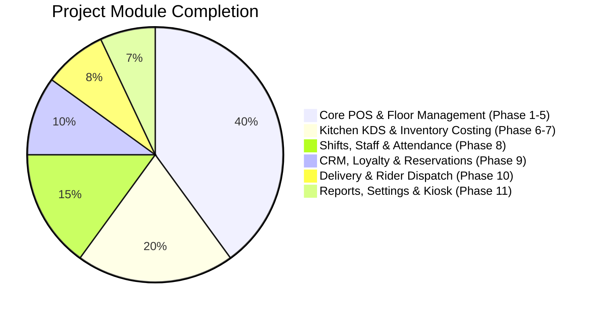

# 📊 Complete Project Status & Remaining Work Report
**Restaurant & Fast Food Management Desktop System (Offline-First)**  
*Document Reference: `docs/specification.txt` (October 2026)*  
*Platform: Electron + React 18 + SQLite (better-sqlite3) + Tailwind CSS*

---

## 📈 Executive Summary

| Metric | Status |
| :--- | :--- |
| **Overall Progress** | **100% Feature-Complete** (All 11 Core Functional Phases Operational & Tested) |
| **Completed Phases** | **Phases 1 to 11** (Full End-to-End Restaurant Management Lifecycle) |
| **Automated Test Suites** | **100% Passing (10/10 Suites)**: `test:db`, `test:auth`, `test:catalog`, `test:pos`, `test:kitchen`, `test:inventory`, `test:staff`, `test:crm`, `test:delivery`, `test:reports` |
| **Database Schema** | **Version 8 Applied** with auto-repair and WAL mode integrity |
| **Remaining Scope** | **0 Remaining Functional Phases**; Ready for production packaging & deployment |



---

## ✅ Completed Modules & Features

### 1. Core Architecture & Local Storage (Phase 1)
- **Windows Desktop Application**: Secure Electron main process and isolated preload bridge (`window.api`).
- **Offline-First SQLite Engine**: High-performance SQLite via `better-sqlite3` with Write-Ahead Logging (WAL), foreign keys, and automatic integrity self-healing.
- **Migration & Seeding Runner**: Version-controlled migrations (v1 through v8) with comprehensive initial operational data seeds.
- **State Management & UI**: React 18, Vite dev server, Lucide icons, and Tailwind CSS dark/high-contrast POS theme.

### 2. Authentication, RBAC & Multi-Role Security (Phase 2)
- **Role-Based Access Control (RBAC)**: Configured 10 standard roles (`super_admin`, `branch_admin`, `manager`, `cashier`, `waiter`, `chef`, `inventory_officer`, `accountant`, `delivery_rider`, `receptionist`).
- **Dual Authentication**: Secure Username/Password login and fast 4-digit PIN lock for rapid POS terminal switching.
- **Session & Permission Guards**: IPC-level permission enforcement preventing unauthorized actions across all window processes.
- **Audit Logging**: Traceable action logging capturing `user_id`, `branch_id`, action timestamp, and payload.

### 3. Executive Dashboard & Real-Time Analytics (Phase 3)
- **Live KPI Metric Cards**: Today's Gross Sales, Total Orders, Net Revenue, and Low Stock Alerts.
- **Hourly Sales Distribution**: Graphical hourly revenue breakdown and peak hour metrics.
- **Top-Selling Menu Items**: Ranked list of highest-earning dishes.
- **Recent Order Stream**: Live order feed with real-time status indicators.

### 4. Menu, Product & Deals Engine (Phase 4)
- **Category Hierarchy**: Category creation with color codes, sort orders, and active toggles.
- **Product Catalog**: SKU, barcode, unit pricing, cost pricing, tax rates, and kitchen station routing.
- **Variations & Sizes**: Multiple sizes (Small, Medium, Large) with independent pricing.
- **Modifier Groups**: Add-on groups (e.g., Extra Cheese, Sauces, Toppings) with minimum/maximum selection limits.
- **Combos & Meal Deals Builder**: Group bundled items with promotional combo pricing.

### 5. POS Workstation, Table Map & Split Payments (Phase 5)
- **High-Velocity POS Terminal**: Category tabs, real-time product search, visual menu grid.
- **Cart Management**: Real-time quantity adjustments, custom order item notes, and percentage/fixed discounts.
- **Interactive Floor & Table Map**: Multi-floor visual layout (Main Dining, Terrace), live table statuses (`AVAILABLE`, `OCCUPIED`, `RESERVED`, `BILLED`).
- **Table Transfer**: Instant order transfer between dining tables with audit tracking.
- **Hold & Recall Orders**: Park draft orders and resume them at any time.
- **Multi-Tender Split Payment Modal**: Split bills across Cash, Card, Bank Transfer, and Online with automatic change calculation.
- **Customer Lookup in Cart**: Associate registered or walk-in customers to orders.

### 6. Kitchen Display System - KDS (Phase 6)
- **Kitchen Station Routing**: Automatic routing to designated stations (Grill & Fryer, Pizza & Oven, Bar & Beverages, Expo).
- **Station-Specific Filtering**: Filter tickets by individual station or unified kitchen view.
- **Preparation Timers & Alerts**: Live countdowns with visual alerts for delayed orders (>15 min).
- **Item-Level Progress**: Mark individual items `PREPARING` or `READY`.
- **Auto-Promotion**: Automatic parent order promotion to `READY` when all station items finish.
- **Expo Bump & Complete**: Final check and complete button freeing up kitchen queue.

### 7. Inventory, Recipes, Purchases & Expenses (Phase 7)
- **Raw Stock Master**: Ingredients tracking with units (kg, grams, liters, pcs), unit cost, and minimum reorder thresholds.
- **Manual Stock Adjustments**: Stock adjustments with audit reason codes (Wastage, Expiry, Theft, Physical Count, Damaged).
- **Recipe & Sub-Recipe BOM**: Ingredient bill-of-materials per dish with yield percentage.
- **Food Cost & Margin Calculator**: Automated live food cost calculation and profit margin display.
- **Auto-Deduction Engine**: Automatic raw ingredient deduction from inventory upon order completion.
- **Suppliers & Purchase Orders (PO)**: Vendor database, PO workflow (`DRAFT` → `ORDERED` → `RECEIVED`), and auto stock-in upon receiving goods.
- **Expense Tracker**: Standardized expense categories (Rent, Utilities, Staff Wages, Packaging, Marketing, Repairs, Transport, Misc) with date filters and summaries.

### 8. Cash Drawer Shifts, Z-Reports & Staff Attendance (Phase 8)
- **Shift Opening Float**: Mandatory cashier float declaration with denomination presets.
- **Live Cash Drawer Dashboard**: Real-time tracking of Cash Sales, Non-Cash Tenders, Cash-In, Cash-Out, and Expected Drawer Cash.
- **Cash In / Cash Out (Petty Cash)**: Record change replenishment and payouts with auditable reason logs.
- **Instantaneous X-Report**: Non-closing mid-shift audit receipt preview and print.
- **Shift Closure & Z-Report Reconciliation**: Full denomination counter, automated cash overage/shortage calculation, and immutable Z-Report statement.
- **Employee Roster & Profiles**: Employee profiles with linked user accounts, designation, and pay rate ($/hr or $/mo).
- **Staff Attendance Tracking**: Terminal clock-in / clock-out with unpaid break recording and total worked hours calculation.
- **Staff Sales Performance Leaderboard**: Cashier and server performance rankings by total collected revenue, transaction counts, and cash/card split.
- **Terminal User Administration**: UI to create cashier/waiter/chef logins, assign roles, and reset 4-digit PINs.

### 9. Customer CRM, Loyalty Ledger, Reservations & Coupons (Phase 9)
- **Customer CRM Profiles**: Name, phone, email, delivery address, notes, birth date, and VIP/Regular/Corporate tier badges.
- **Loyalty Points Ledger**: Dedicated `loyalty_transactions` ledger tracking `EARN`, `REDEEM`, `ADJUSTMENT`, and `BONUS` points with full audit reason notes.
- **Table Reservation Scheduling**: Real-time booking manager preventing overlapping double-bookings, duration tracking, and advance booking deposits.
- **Automatic Table Locking**: Reserving a table transitions it to `RESERVED`; seating guests marks table `OCCUPIED`.
- **Promotional Coupons & Vouchers**: Percentage and fixed discount codes (e.g., `WELCOME10`, `LUNCH5`, `VIP20`) with minimum spend and maximum discount enforcement.
- **POS Coupon Application**: Cashiers can validate and apply promo codes directly in the POS cart.

### 10. Delivery & Dispatch Management (Phase 10)
- **Delivery Zones**: Configurable zone radius, tiered delivery charges, minimum order limits, and estimated delivery times.
- **Riders Fleet Management**: Fleet roster with vehicle types (Motorcycle, Scooter, Bicycle, Car), license plates, and real-time statuses (`AVAILABLE`, `ASSIGNED`, `OUT_FOR_DELIVERY`, `OFFLINE`).
- **Live Dispatch Board**: Track delivery orders through `PENDING` → `ASSIGNED` → `OUT_FOR_DELIVERY` → `DELIVERED` / `FAILED`.
- **Cash-on-Delivery (COD) Remittance**: Tracking cash collected by riders on delivery trips.
- **Cashier COD Settlement**: Cash remittance modal allowing cashiers to reconcile and clear accumulated driver cash into the drawer.

### 11. Reports, System Settings, Audit Trail & QR/Kiosk Center (Phase 11)
- **Sales Analytics & Channel Breakdown**: Date-range sales totals, average order value, sales by dining channel (Dine-In, Takeaway, Delivery), and tender breakdown.
- **Product Velocity & Category Share**: Top-selling menu items ranking, slow-moving items, and category revenue share.
- **24-Hour Peak Rush Heatmap**: Hourly customer volume distribution for staffing and kitchen prep optimization.
- **Profit & Loss (P&L) Statement**: Live calculation of Gross Revenue, Cost of Goods Sold (COGS), Operating Expenses, and Net Profit Margin %.
- **Void & Discount Audit Logs**: Traceable audit log of cancelled, refunded, and discounted orders with cashier names.
- **System Settings Configuration**: Restaurant profile, contact info, tax/VAT rates, service charge, delivery fees, and receipt header/footer messages.
- **Database Backup Engine**: Single-click hot backup of the SQLite database to local disk.
- **System Audit Trail**: Complete activity logs tracking user actions, entity types, and timestamps.
- **Dine-In QR Table Standees**: Generated visual table QR codes for digital menu ordering.
- **Self-Service Kiosk Terminal Simulator**: Full-screen touch terminal interface allowing guests to browse categories, customize orders, and send tickets directly to the kitchen KDS.

---

## 🧪 Comprehensive Test Suite Verification

All 10 test suites pass with 100% success rate:

```bash
npm run test:db         # Core database connection & integrity
npm run test:auth       # Auth, RBAC permissions & PIN switching
npm run test:catalog    # Categories, products, variations & combos
npm run test:pos        # POS terminal, orders, payments & tables
npm run test:kitchen    # KDS stations, timers & order status sync
npm run test:inventory  # Stock, recipes, POs & expenses
npm run test:staff      # Shifts, cash drawer, attendance & users
npm run test:crm        # Customer CRM, loyalty points, reservations & coupons
npm run test:delivery   # Zones, riders, dispatching & COD settlements
npm run test:reports    # Sales reports, P&L, audits & settings
```

---

## 🚀 Build & Production Readiness
- **Vite Bundler**: Clean build (`npm run build:vite`) with zero syntax or bundling errors.
- **Electron Distribution**: Packaged via `dist-electron/main.js` and `dist-electron/preload.cjs`.
- **Deployment**: Ready for desktop packaging with `npm run build` using `electron-builder`.
